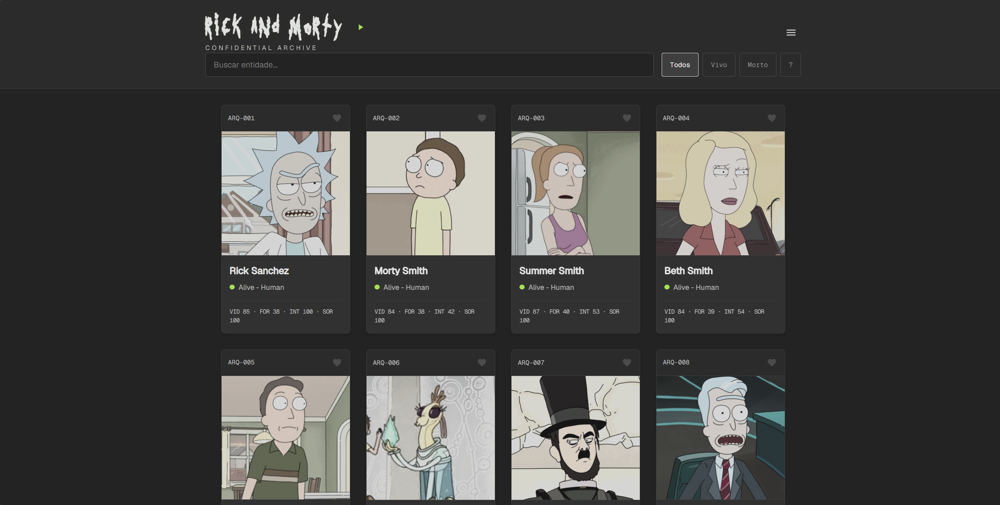

<div align="center">

# Rick and Morty: Arquivo Confidencial

[](https://developer.mozilla.org/en-US/docs/Web/JavaScript)
[](https://developer.mozilla.org/en-US/docs/Web/HTML)
[](https://developer.mozilla.org/en-US/docs/Web/CSS)
[](https://developer.mozilla.org/en-US/docs/Web/API/Web_Audio_API)
[](#)
[](LICENSE)

<br />



<p align="center">
  <strong>Aplicação web gamificada construída em Vanilla JS puro, sem frameworks ou bibliotecas externas, consumindo a API oficial de Rick and Morty.</strong>
</p>

</div>

---

## 🛰️ Visão Geral

O projeto nasceu a partir de um requisito prático da disciplina de **Web Development Front-End (UniFECAF)**. O objetivo inicial exigia o consumo de uma API pública via `fetch()` e a geração de cards dinâmicos manipulando o DOM.

Expandimos o escopo para um sistema gamificado completo com estética da **Federação Galáctica**. O projeto inclui catálogo interdimensional com busca e paginação dinâmicas, economia persistente em Flurbos, Arena Rogue-Like de combate por turnos, sintetizador de áudio procedural e minigame secreto.

Seguimos três regras de engenharia:
1. **Zero Frameworks:** Construído exclusivamente com HTML5, CSS3 e JavaScript puro. Sem React, sem Vue e sem bundlers (Vite, Webpack).
2. **Execução Nativa Direta:** Roda diretamente via protocolo `file://` com duplo clique em `index.html`. Não depende de build step ou servidores locais para funcionar.
3. **Manipulação Real do DOM:** Cards construídos programaticamente via `document.createElement` e `appendChild`.

---

## 📸 Interface do Usuário

<div align="center">

| Dossiê da Federação | Rádio Interdimensional |
| :---: | :---: |
|  |  |

| Recrutamento da Arena | Duelo por Turnos |
| :---: | :---: |
|  |  |

| Mercado Clandestino | Adaptação Mobile Nativa |
| :---: | :---: |
|  |   |

</div>

---

## ⚡ Funcionalidades

### 1. Catálogo e Dossiê da Federação
- Busca com debounce e filtros de estado vital (Vivo, Morto, Desconhecido) direto na API oficial.
- Efeito 3D Tilt com reflexo de luz radial nos cards via cursor do mouse (desativado automaticamente em telas touch para não travar a rolagem).
- Dossiê detalhado com lista completa de episódios e ficha técnica estendida.

### 2. Motor Determinístico de Atributos de RPG
Não usamos atributos randômicos voláteis. Os atributos de combate (Vida, Força, Inteligência e Sorte) são derivados matematicamente a partir de dados imutáveis de cada personagem na API (ID, tamanho do nome, espécie e contagem de episódios). O mesmo personagem sempre terá a mesma ficha técnica em qualquer sessão.

### 3. Arena de Duelo Rogue-Like
- Agência de recrutamento com seleção paginada de 42 combatentes mesclando favoritos, cache e aleatórios.
- Mecânica de combate em turnos com escalada de dificuldade por estágio.
- Dreno visual de cor no card via `clip-path` proporcional ao dano recebido em batalha.
- 30 cartas de relíquias e buffs com lore oficial da série e bordas estilizadas de gosma de portal em SVG.

### 4. Mercado Clandestino e Economia
- Moeda galáctica (*Flurbos*) armazenada e sincronizada via `localStorage`.
- Compra de vagas adicionais para o esquadrão de combate (de 1 até 5 lutadores).
- Compra de transmissões e itens secretos.

### 5. Rádio Interdimensional Inline
Player minimizado no cabeçalho com 5 frequências de streaming ao vivo e uma faixa local secreta desbloqueável (*Human Music*).

---

## 🛸 Segredos e Easter Eggs

* **A Noite do Expurgo:** Digitar `expurgo` ou `purge` na barra de pesquisa ativa um minigame secreto de 30 segundos. Ele conta com mira tática customizada, trilha sonora exclusiva (`expurgo.mp3`), portais animados e mineração de Flurbos por alvo abatido.
* **Nave do Rick:** Evento temporizado onde a nave cruza a tela. Clicar rapidamente nela concede Flurbos (com bloqueio nativo contra arraste e seleção fantasma de imagem).

---

## 🛠️ Engenharia e Arquitetura

* **Cache em Memória e Proteção Anti-429:** A API pública aplica restrições estritas de requisições. Implementamos um cache em memória baseado em `Map` e um pool canônico de reserva em `api.js`. Quando a API retorna erro `HTTP 429 Too Many Requests`, o jogo recorre aos dados locais sem interromper a execução.
* **Sintetizador Procedural de Áudio:** Efeitos sonoros de interface e combate gerados via **Web Audio API** (`AudioContext`, osciladores de frequência e filtros biquad), reduzindo a dependência de arquivos externos de mídia.
* **Ergonomia Mobile Nativa:** Adaptação completa via `@media (max-width: 768px)` e seletores de toque (`pointer: coarse`). Controles de ação posicionados ao alcance do polegar na base da tela e layout redimensionado para telas pequenas.

---

## 🚀 Como Executar

O projeto não requer instalação de pacotes nem compiladores:

### Opção 1: Duplo Clique (Recomendado)
Basta clonar ou baixar o projeto e abrir o arquivo `Confidential/index.html` em qualquer navegador moderno.

### Opção 2: Servidor Estático Local
Caso queira executar via servidor local:

```bash
# Com Node.js
npx serve Confidential

# Com Python
python -m http.server 8000 --directory Confidential
```

---

## 👨‍💻 Autor e Créditos

Desenvolvido por **Pedro** no curso de **Web Development Front-End** da **UniFECAF**.

* **API:** [The Rick and Morty API](https://rickandmortyapi.com/)
* **Fontes Locais:** Geist, Geist Mono e Get Schwifty
* **Licença:** Distribuído sob a licença [MIT](LICENSE).
